<div align="center">

**简体中文** | [English](README.en.md)


# 广告分镜师

> *「你出创意，它把广告拍出来。」*

[](LICENSE)
[](https://claude.com/claude-code)
[](https://higgsfield.ai)
[](https://www.feicaiclub.cn)

**把广告分镜师放进项目文件夹，Claude Code 就能替你拍广告。**

你给产品图和创意，Opus 5.5 当导演：问清要求，把脚本拆成能生成的段，<br>
接 Higgsfield 一段一段生成，派一个只读的审片员逐段挑错，剪成片、自审、交片。<br>
上面这支 41 秒的 Roadster 广告，是它一个下午做出来的。Studio 放映室也一起开源了。

[看效果](#看效果) · [安装](#安装) · [能做什么](#能做什么) · [怎么做到的](#怎么做到的) · [Studio](#studio-放映室) · [局限性](#局限性) · [关于作者](#关于作者)

</div>

---

## 看效果

<!-- VIDEO -->

这支 41 秒的 Roadster 广告是广告分镜师做的，记得开声音。整个制作过程我做成了一期 20 分钟的教程《我用 Opus 5.5 做了一支特斯拉广告》，在 [B站](https://space.bilibili.com/3546566589679687) 和 [YouTube](https://www.youtube.com/@feicaiclub)。

### 我做的，就这几件事

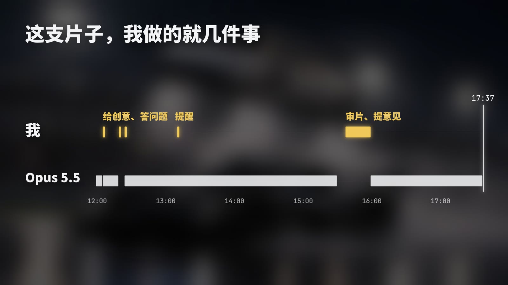

12:05 交创意脚本，12:19 答完它的问题，13:10 插了一句"车特别假"，15:30 它交第一版。我在 Studio 里审完片、补了几条要求，17:37 交第二版。上面那条短短的是我，下面那条长的是 Opus 5.5。

### 剩下的，全是它做的

<table><tr>
<td width="50%">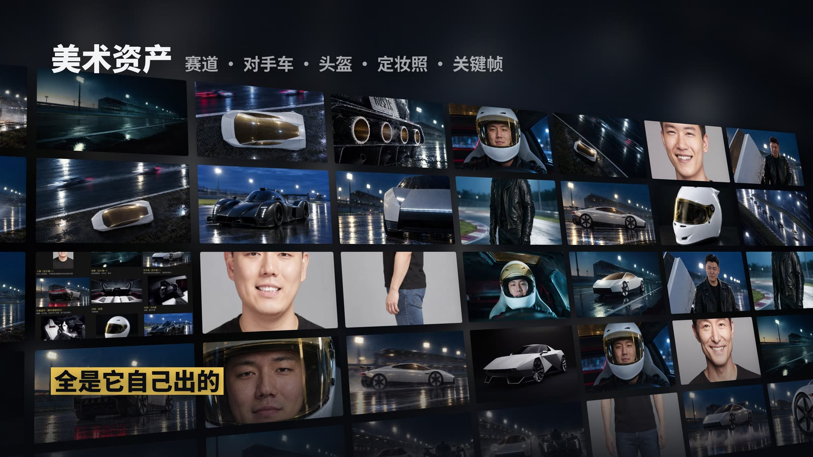<br/>美术资产：赛道、对手车、头盔、定妆照、关键帧，都是它自己出的</td>
<td width="50%">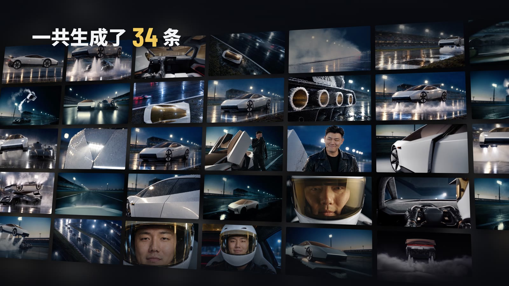<br/>一共生成 34 条视频。它先只用 480p 试拍开场这一段，确认没问题才铺开</td>
</tr></table>

每一张图、每一条视频背后都有提示词，加起来约一万六千个英文单词，全是它按每一镜自己写、原样发出去的。两版交完，Higgsfield 账上的积分从 1753 用到 1.82。

### 第一版到第二版

<table><tr>
<td width="50%">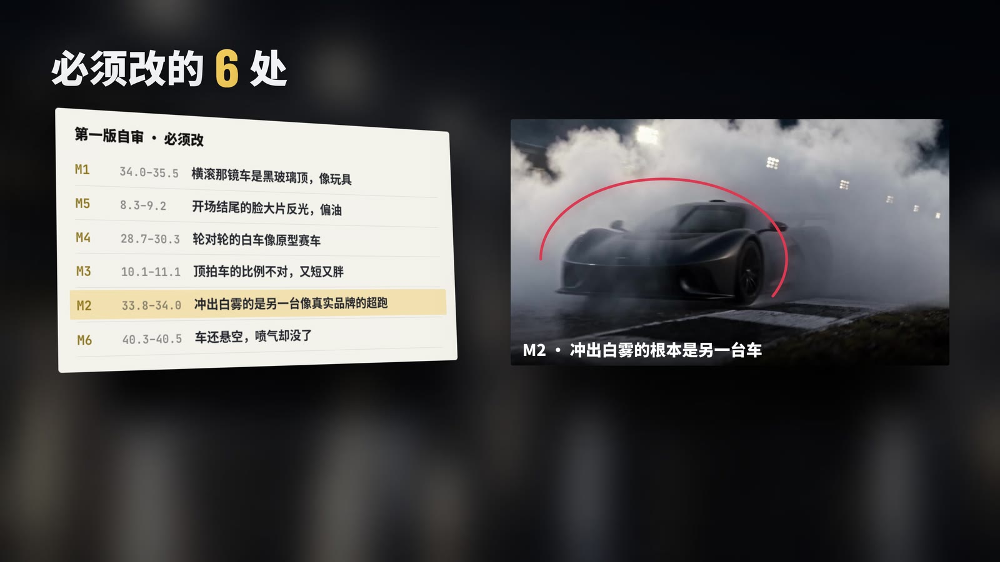<br/>第一版交片前，审片员挑出 6 处必须改的，每一处都标到秒</td>
<td width="50%">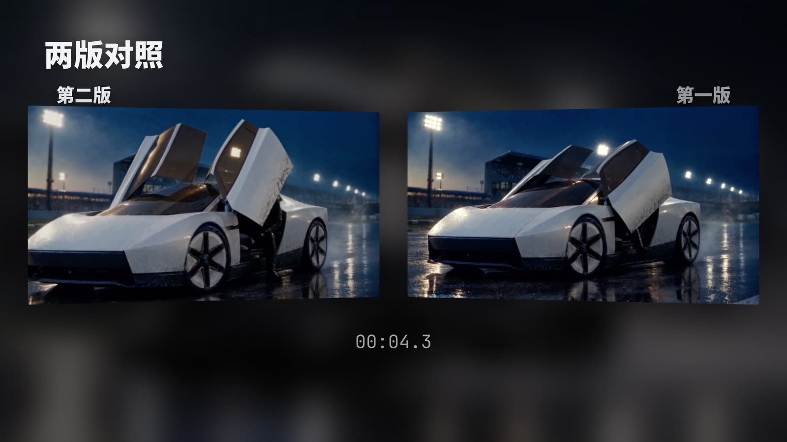<br/>第二版（左）和第一版（右），同一时间点并排看</td>
</tr></table>

---

## 安装

### 1. 装好 Higgsfield

最省事的办法：打开 [Higgsfield](https://higgsfield.ai) 官网的 MCP 页，选 **Claude Code** 标签，复制那段官方安装提示词，粘进 Claude Code 发送。它会装好命令行，带你登录（浏览器里点一下授权），再装上 8 个官方 Skill。

<details>
<summary>想自己敲命令</summary>

```sh
npm i -g @higgsfield/cli
higgsfield auth login                  # 浏览器里点一下授权
higgsfield workspace set <你的工作区>    # 不设会报 No workspace selected
npx skills add higgsfield-ai/skills
```

</details>

### 2. 拿到广告分镜师

广告分镜师就是一个 `.claude` 文件夹。克隆下来的仓库，可以直接当你的项目文件夹：

```sh
git clone https://github.com/feicaiclub/ad-storyboarder.git 我的第一支广告
cd 我的第一支广告
claude
```

已经有项目文件夹的，把 `.claude` 拷进去就行。

### 3. 开始做第一支片子

用 Claude Code 打开项目文件夹，把要做的东西交给它：产品图、你的想法和要求，有拍摄脚本就一起给；有人出镜，再加上出镜者的照片。

开工前它会先自检：Higgsfield 装没装、登没登录、选没选工作区，账上还有多少积分，本机缺什么、怎么装，都会告诉你。有脚本，它读完脚本、清点你给的参考，只问几个脚本答不了的问题；没有脚本，它先把需求问清，再出几个创意方向让你挑。

### 需要什么

- Claude Code，模型用 Opus 5.5。我只在它上面实测过。
- Higgsfield 账号和积分。我用的是 Ultra 套餐，这支片子两版用了约 1750 积分。
- ffmpeg、Python 3（numpy、Pillow）、一种中文字体；片子里有台词或旁白，还要本地 whisper 做听写。
- 目前只在 macOS 上跑过。缺什么自检都会说，也可以直接让它帮你装。

---

## 能做什么

写给做广告、做片子的人。广告分镜师可以从头接一整支片子，也可以只接其中几个环节：六个 Skill 各管一段，单独调用也行。

| 环节 | 它能帮你做什么 |
|---|---|
| 提案、比稿 | 创意方向定了两三个，各出一段样片拿去比稿。客户看到的是会动的画面，不是一页页分镜 |
| 前期 | 把创意脚本拆成分段表（每段的镜头、时长、参考、声音）；把产品的颜色、logo、材质、结构写成产品造型表；客户的每条要求，按原话、带日期记进需求文档 |
| 拍不了、拍不起的镜头 | 飞车、特效、极端天气、危险动作、难协调的外景，直接生成。生成的每一段都是单独的视频文件，剪进你的实拍片里也行 |
| 产品片、电商视频 | 产品图是必需输入。颜色、logo、字、结构和产品图对不上的镜头，再好看也不入片 |
| 代言人、真人出镜 | 用本人的照片认人（要本人授权），每段入片前都和照片比对，脸跑了就重出 |
| 客户返修 | 反馈先问透：哪一镜、哪里不对、改成什么样、哪些不能动，然后只重出受影响的段；交付说明分开写"客户指出的"和"我们自己改的" |
| 多平台投放 | 同一支片子按交付规格各出一版（横版、竖版、不同分辨率），每一版各自过门禁 |
| 控预算 | 开工前定积分上限；花钱前先估价、报余额，超了先问；新做法先出一段低清样片，确认了再铺开；花完拿流水对账 |
| 审片、对版 | 在 Studio 里逐帧打标记、两版并排对照；团队审完，一次性交给它改 |

它会主动停下来问你的只有四件事：花钱超出上限、删你的文件、对外发布、动你的账号。其余的它自己定，交片时列一张"替你定了什么"。

---

## 怎么做到的

### 一个导演，六件事

`CLAUDE.md` 里没有写流水线，只写了一支片子做完要满足的六件事：需求问透了、脚本定了、参考齐了、每段过审了、成片过门禁了、交了。哪一件还没成立、它依赖的又都已成立，就去做那一件。所以它可以跳过（没有旁白就不配音），可以回头（审出产品走样就划掉重出），也可以穿插（剪到一半缺一个特写，回去补拍）。

### 分段表就是进度表

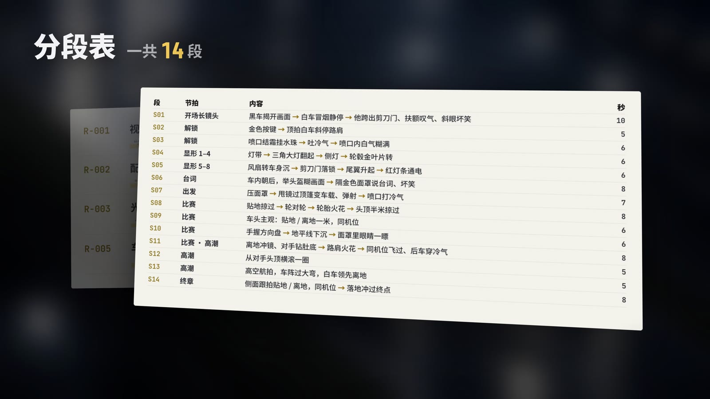

脚本拆成分段表，一段一次生成。一段一行、六格：脚本、参考、生成、过审、入片、验收。哪一格空着，哪一格就是下一步；你的反馈指向哪一段，就把那一段的格子划掉重来。

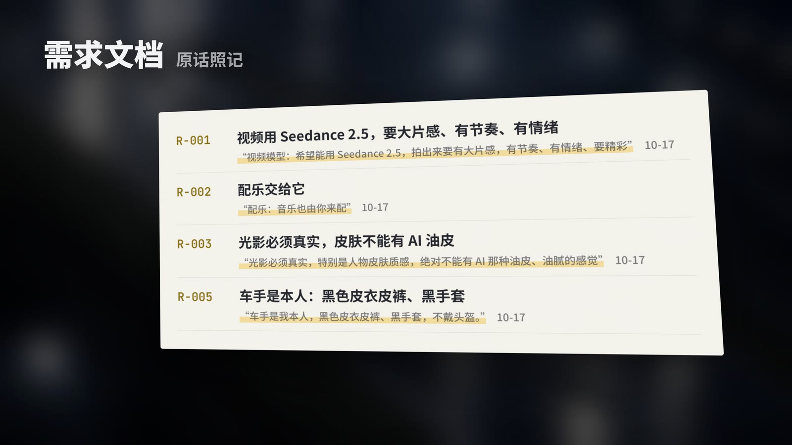

你说过的每一条要求，都按原话、带日期记进需求文档。后面剪辑、审片，它都会回头对照你当时说的话。

### 一个只读的审片员

`agents/inspector.md` 是一个只找问题、不改任何文件的 Agent。它抽帧拼图、把产品和人脸跟你给的图并排、听写、量数，按十项逐一核：产品、人物、崩坏、AI 味、文字与品牌、声音、肤质、布景与方向、参考搬入、运动量，交回一份带时间码的问题清单。每段入片前派一次，成片自审派一次，修完再派一次核实。

### 门禁只兜底，不设上限

尺子（`measure`、`qa`、`pick`、`review_seg`、`gate`、`doctor`）只量不改。说"做完了"必须附上门禁的输出，没量过就说"没量"。规矩管的是底线：产品对、人对、不崩、声音过门禁、花钱有数。提示词由它按每一镜写、原样发出，没有任何默认的风格块；模型和 Higgsfield 本身能做的，规矩不拦。

### 剪辑是最便宜的修法

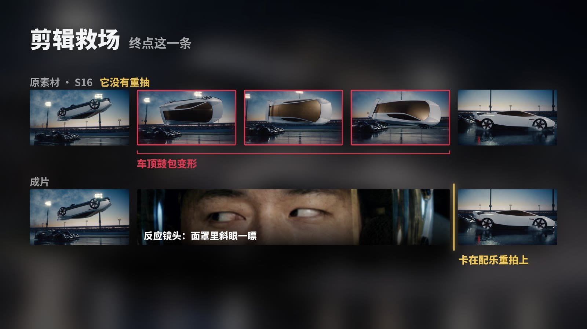

终点那一条，车翻正、下落的那一秒多，车顶鼓包变形。它没有重抽：在车倒扣在对手头顶的那一刻，插了一个面罩里斜眼一瞟的反应镜头，切回来车已经落地，正好卡在配乐的重拍上。审片员会把每条里能用的段落标到秒，剪的时候只拿能用的部分。

### 踩过的坑，写回 harness

`tools/adapters/Higgsfield 实测.md` 只记实测出来的事实，每条带日期，这一版有 36 条。比如：

- 官方渲染图（棚拍底）直接挂成 Seedance 的产品参考，车会带一股 CG 味；镜头构图像哪张效果图，就把那张图的机位、棚拍地板整个搬进画面。
- 草稿升级不管升到 720p 还是 1080p，都按 1080p 的价收。做 720p 的片子，直接出 720p。
- Seedance 2.5 用参考模式、只挂一套参考（场景、车外观、车尾、对手车各一张），比拿关键帧当首帧动得更真，人和车前后也更一致。

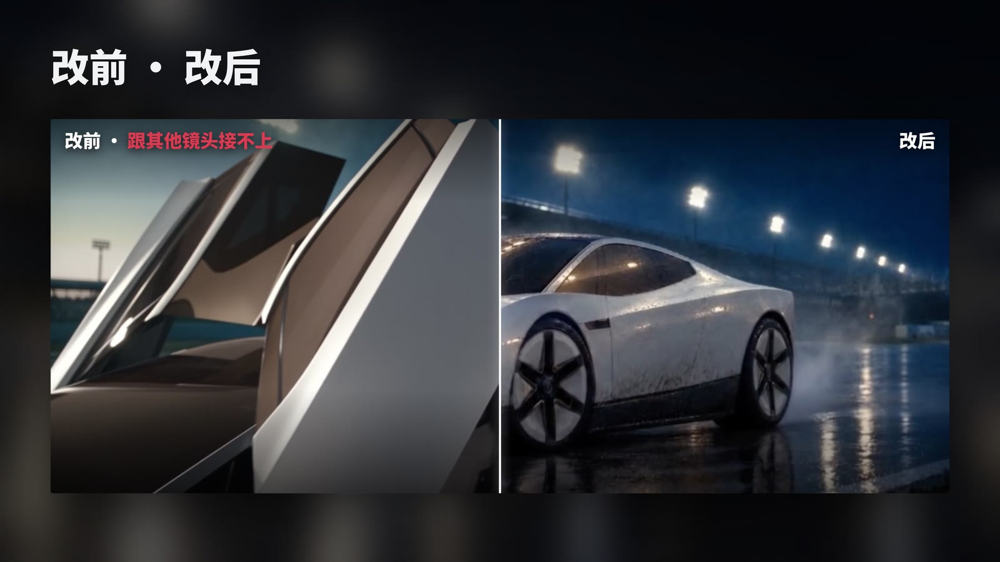

---

## Studio 放映室

Studio 也开源了，就在 `.claude/tools/studio.py` 和 `studio.html` 里，不用另外装。说一句「打开放映室」，或者输入 `/ad-studio`，它在后台起一个本机网页，开在 Claude Code 的内置浏览器里，就在对话旁边。

### 逐帧打标记

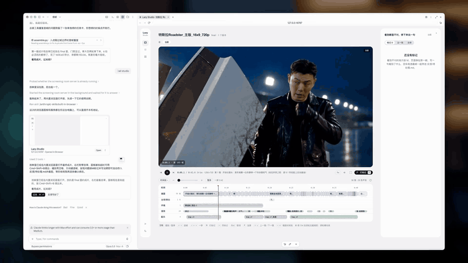

空格播放，左右键逐帧，按 M 打标记，写一句、回车，就带着时间码和截帧存进 `反馈/待处理.md`。全片审完一次性交给它改，比截图、打字描述准得多，也快得多。

### 两版对照

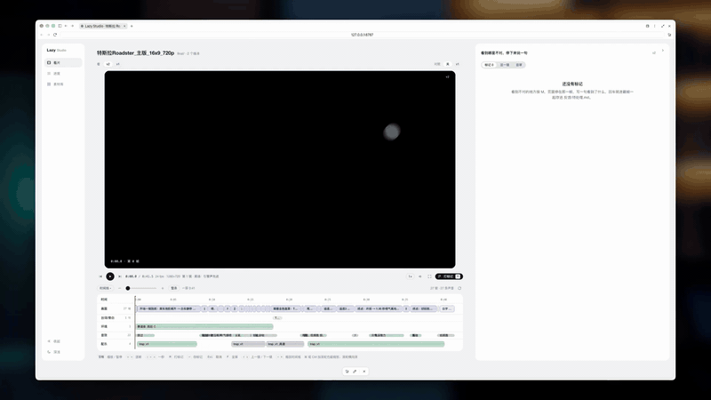

左边新版、右边旧版，同一时间点并排放；时间线上点哪，两边一起跳到哪，差在哪一眼就看得出来。

### 自审、进度、素材库

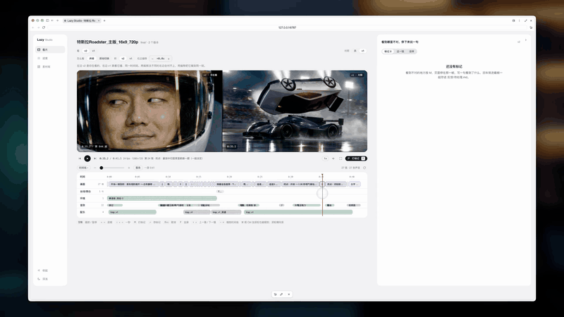

自审页是它交片前自己写的报告：你提的问题怎么改的，它自己又改了什么，还有哪些没解决。进度页就是分段表，点开一段，能看到这一段的提示词、全部候选和选中的那条。素材库里是产品图、人物和它做的定妆照。

页面只绑本机，只读项目里的文件；除了 `反馈/`，不写任何东西。

---

## 里面有什么

| | |
|---|---|
| 导演的规矩 | `CLAUDE.md`：六件事、进度表、怎么问你、什么时候必须找你 |
| 6 个 Skill | 拷问 `/ad-grill` · 脚本 `/ad-script` · 参考 `/ad-refs` · 生成 `/ad-shoot` · 剪辑 `/ad-edit` · 自审 `/ad-review` |
| 审片员 | `agents/inspector.md`，只读 |
| 放映室 | `/ad-studio`：`tools/studio.py` + `tools/studio.html` |
| 尺子 | `measure` `qa` `pick` `review_seg` `gate` `doctor`，只量不改 |
| 后端 | `tools/adapters/higgsfield.py`，唯一的后端，提示词原样发出；旁边的 `Higgsfield 实测.md` 记坑 |
| 守门 | `hooks/secrets-guard.sh`：拦会打出登录令牌的命令、像密钥的字符串、带密钥的提交 |

```
.claude/
├── CLAUDE.md                导演的规矩
├── settings.json            挂上凭证守门
├── skills/                  ad-grill · ad-script · ad-refs · ad-shoot · ad-edit · ad-review · ad-studio
├── agents/inspector.md      审片员
├── hooks/secrets-guard.sh   凭证守门
└── tools/                   尺子、总装、分段任务、放映室、Higgsfield 后端和实测记录
```

跑起来以后，它在项目文件夹里建这些：

```
需求文档.md    脚本/    素材库/    生成/    剪辑/    final/    反馈/
```

---

## 局限性

- **创意得是你的。** 在广告行业，别指望模型自带创意。它能把你的想法执行出来、拍出来，想法本身得你给。这支 Roadster 广告，只打"会飞"和"快"两个卖点、每一个镜头怎么拍，是我看完发布会想好，跟 Fable 5.1 一起写成创意脚本，再交给它的。
- **Opus 5.5 是导演，不是作者，也不是编剧。** 它把你的脚本拆成能生成的段，调模型、审片、剪辑。它接的生图、视频、音乐、音效模型，都是工具。
- **它对你有要求。** 你得看得出"车假""不连戏"。第一版不连戏，是我自己回头看出来的：下车之后接的特写拿一张关键帧当了首帧，人就换了。第二版的几条改法，也是我提的。
- **不是每个镜头都能出来。** 物理上复杂的动作会变形（空中横滚以后翻正的那一秒，车顶会鼓起来），最后靠剪辑躲开；脸和产品会漂，靠参考和审片兜底，兜不住的就不入片。
- **要花钱。** 生成都在 Higgsfield 上，按积分算；一种新做法第一次用，会有探路的成本。
- **它听不见，也看不准。** 声音靠听写和量数，画面靠抽帧和拼表，最后一眼还得是你。
- 只在 macOS、Claude Code、Opus 5.5 上实测过。Higgsfield 的模型和价格变得快，以实测记录为准。

---

## 遇到问题

跑不起来，或者哪条规矩不合你的片子，欢迎开 issue，写清楚卡在哪个 Skill、哪一步。

想跟一群也在做 AI 视频、写 Agent 的人一起琢磨，[废才俱乐部](https://www.feicaiclub.cn)有个会员社群，大家在里面聊正在跑的工作流、互相救急，我每天也在。

---

## 致谢

- 生成能力来自 [Higgsfield](https://higgsfield.ai) 的官方命令行和 Skill，视频主力是 Seedance 2.5。
- Studio 的界面用的是毒舌产品经理 6.0 的出厂设计。
- 演示片是自制的概念广告，与特斯拉官方无关。

---

## 关于作者

**废才** — 废才俱乐部主理人，AI Builder 与知识分享者，专注 AI Agent、编程和影视创作。每个工作流都先自己跑通，再把能复用的部分拆出来开源。

- 著有《驱动 AI 提示词：指令入门与场景应用》（清华大学出版社）
- 毒舌产品经理系列、Seedance 分镜师系列的开发者
- 开源作品：[video-spec-builder](https://github.com/feicaiclub/video-spec-builder)（1000+ ⭐）· [previz](https://github.com/feicaiclub/previz) · [剧本拆解工作流](https://github.com/feicaiclub/script-breakdown-dsh) · [DeepSeek Harness 白皮书](https://github.com/feicaiclub/deepseek-harness-whitepaper)
- AIGC 实战教程更新到第 114 期

广告分镜师只是我 AI 视频工作流里的一环。剧本怎么拆、短剧怎么拍、Seedance 分镜师系列怎么一版版长出来，都在[废才俱乐部](https://www.feicaiclub.cn)。

| | |
|:---|:---|
| 🌐 官网 | [www.feicaiclub.cn](https://www.feicaiclub.cn) |
| 𝕏 Twitter | [@zhu185178](https://x.com/zhu185178) |
| 📺 B站 | [废才俱乐部Club](https://space.bilibili.com/3546566589679687) |
| ▶️ YouTube | [@feicaiclub](https://www.youtube.com/@feicaiclub) |
| 📕 小红书 | [废才俱乐部](https://www.xiaohongshu.com/user/profile/5c6ec0c20000000010032d24) |
| 🎵 抖音 | 搜「废才俱乐部」 |
| 💬 公众号 | 微信搜「废才俱乐部」 |

## 许可证

代码和文档：MIT。随便用，随便改。

例外：演示片、动图和截图里的人像是作者本人，片中 Roadster 的造型属于特斯拉，只作演示，不随 MIT 授权。

---

<div align="center">

**[video-spec-builder](https://github.com/feicaiclub/video-spec-builder)** 把想法逼成分镜脚本。**[previz](https://github.com/feicaiclub/previz)** 生成之前先看白模预演。**广告分镜师** 让 Claude Code 替你拍广告。

MIT License © [废才俱乐部](https://www.feicaiclub.cn)

</div>

---

<div align="center">
<sub>作者的社区 · 也是这些工作流长出来的地方</sub>

[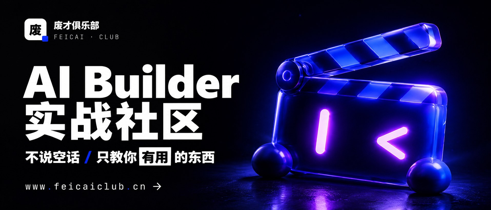](https://www.feicaiclub.cn)

</div>
